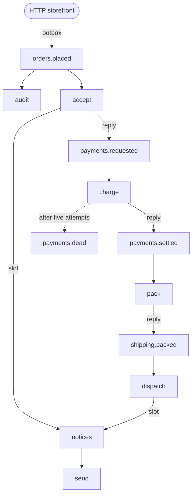

# Build a service, step by step

Eleven chapters grow one RustStream service, a small shop, from its first subscriber to a networked broker.

The shop takes an order, charges it, ships it and tells the customer.
Each step is a subscriber, and the steps talk to each other through topics.
The shop runs on the in-memory broker, so every chapter runs with nothing to install.
Each chapter adds the components it needs and links to their pages in [Components](../../components/index.md).
Every code block has two tabs: `Macros` with the attributes and derives, `Manual` with the same code written by hand.

The finished shop lives in [`examples/guide`](https://github.com/powersemmi/ruststream/tree/main/examples/guide) in the repository, and its manual twin in [`examples/manual/guide`](https://github.com/powersemmi/ruststream/tree/main/examples/manual/guide).
CI builds both and runs their tests on every change.
Each side of the shop is a module: `orders.rs`, `payments.rs`, `shipping.rs` and `notifications.rs`.
`state.rs` holds what the subscribers share, `observability.rs` a middleware of the shop's own, and `service.rs` assembles the app.
`main.rs` is the command-line entry point, and `http.rs` runs the same shop beside an HTTP server.
