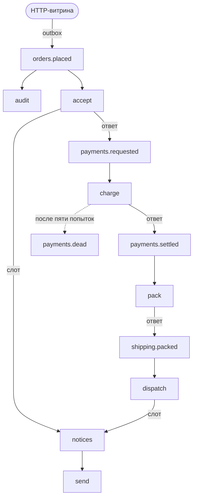

# Строим сервис шаг за шагом

Одиннадцать глав строят один сервис на RustStream, небольшой магазин: от первого подписчика до сетевого брокера.

Магазин принимает заказ, списывает оплату, отправляет заказ и уведомляет покупателя.
Каждый шаг - это подписчик, и шаги обмениваются сообщениями через темы.
Магазин работает на in-memory брокере, поэтому для любой главы ничего не нужно устанавливать.
Каждая глава подключает нужные ей компоненты и ссылается на их страницы в разделе [Компоненты](../../components/index.md).
У каждого блока кода две вкладки: «Макросы» с атрибутами и derive-макросами и «Вручную» с тем же кодом, написанным без них.

Готовый магазин лежит в репозитории в [`examples/guide`](https://github.com/powersemmi/ruststream/tree/main/examples/guide), а его ручная версия - в [`examples/manual/guide`](https://github.com/powersemmi/ruststream/tree/main/examples/manual/guide).
CI собирает обе версии и запускает их тесты при каждом изменении.
Каждая часть магазина - отдельный модуль: `orders.rs`, `payments.rs`, `shipping.rs` и `notifications.rs`.
`state.rs` содержит то, что подписчики используют совместно, `observability.rs` - собственный middleware магазина, а `service.rs` собирает приложение.
`main.rs` - точка входа командной строки, а `http.rs` запускает тот же магазин рядом с HTTP-сервером.
