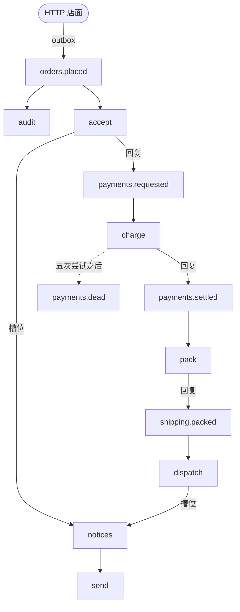

# 逐步构建一个服务

十一章内容逐步扩展同一个 RustStream 服务（一家小商店），从第一个订阅者一直到联网的 Broker。

商店接收订单、收款、发货，并通知顾客。
每一步是一个订阅者，各步之间通过主题通信。
商店运行在内存 Broker 上，所以每一章都不需要安装任何东西。
每一章引入它需要的组件，并链接到[组件](../../components/index.md)中对应的页面。
每个代码块有两个标签页：“宏”使用属性和 derive，“手写”是手工写出的同一段代码。

完成后的商店位于仓库的 [`examples/guide`](https://github.com/powersemmi/ruststream/tree/main/examples/guide)，手写版本位于 [`examples/manual/guide`](https://github.com/powersemmi/ruststream/tree/main/examples/manual/guide)。
CI 在每次改动时构建这两者，并运行它们的测试。
商店的每个部分是一个模块：`orders.rs`、`payments.rs`、`shipping.rs` 和 `notifications.rs`。
`state.rs` 存放订阅者共享的内容，`observability.rs` 是商店自己的一个中间件，`service.rs` 组装应用。
`main.rs` 是命令行入口，`http.rs` 让同一个商店运行在 HTTP 服务器旁边。
